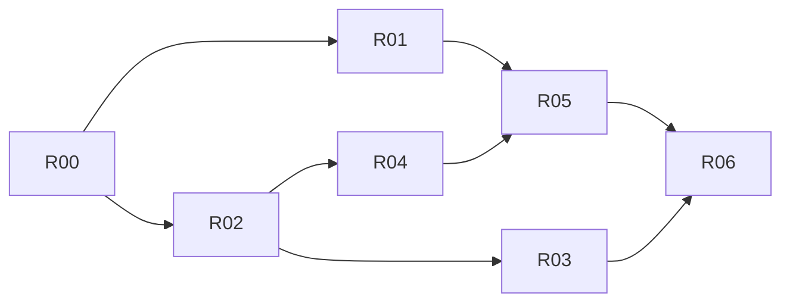

# Orbit final scope: private service, measurement and write-up

Date: 2026-10-11. Source facts were read at `5e61ac2` and must be re-checked
before editing. This plan is the implementation handoff; the
[tracker](implementation/final-status.md) records progress and evidence,
[packets](implementation/final-packets.md) hold acceptance detail and
[gates](implementation/final-gates.md) hold the design questions to close.

## Decision

On 2026-10-11 the owner chose to finish Orbit as a **distributed systems and
networking project**, not a product for public users:

1. **Zero operating cost and no public dependency.** The owner's Oracle VPS
   stops serving the public. Its `orbit-net` instance admits only the owner's
   devices. Public builds ship without a default hosted service; anyone else uses
   LAN mode or runs their own `orbit-net` (bring your own service, which already
   exists as self-hosted mode).
2. **Make self-hosting easy**, so an evaluator can run the full system, including
   WAN traversal and relay fallback, on their own hosts.
3. **Measure and explain.** The remaining effort goes into evidence: how often
   direct connections succeed on real networks, relay fallback time, throughput,
   convergence under partitions, crash recovery and resource use, then an updated
   case study.

This replaces the drafted bring-your-own-relay design (relay-only role, setup
links, a second service client, relay sharing and sponsored pairing), which was
product convenience rather than systems value. Desktop notifications, timed
pause, "Sync now", permission-bit sync and ignore patterns are also out of scope.

Interim protection (before R02 ships): lowering the hosted `relay_month_bytes`
so public relaying stops is an owner-confirmed operation recorded in R00.

## Start here

1. Inspect the working tree and the [tracker](implementation/final-status.md).
2. Read [scope](portfolio-scope.md) (2026-10-11 amendment), [glossary](../CONTEXT.md),
   [WAN architecture](orbit-wan-architecture.md) (W13, W14 sections),
   [network protocol](orbit-wan-protocol.md), [WAN UX](orbit-wan-ux.md),
   the [operator guide](orbit-net-operator.md), [verification](verification.md)
   and the [case study](case-study.md).
3. Read the first eligible packet in [packets](implementation/final-packets.md)
   and its gate in [gates](implementation/final-gates.md).
4. Implement through the owning modules, run the packet's checks and record
   actual results in the tracker. Continue eligible work without a per-packet
   approval ritual.

Earlier plans (P/O/T/W/E) remain historical baselines with preserved evidence.
Engine guarantees are unchanged: causal history, capture before replacement,
reviewed mutations, pinned device identities, per-request folder authorization
and end-to-end encryption through any relay.

## Result

- The owner's PC, laptop and Pi keep Automatic connectivity (discovery, STUN,
  ICE, relay fallback) through the VPS, which refuses every other device.
- A fresh public build starts in a clear state: LAN sync works; WAN connectivity
  says "No Orbit service configured" and points to self-hosting.
- `orbit-net init` produces a working self-hosted service in one command and
  prints the exact `orbit network set` command for devices.
- Each device reports how much of its peer traffic went direct versus relayed.
- A measurement campaign and an updated case study present the results,
  including negative results and the guarantees Orbit deliberately does not make.

## Packets

| Packet | Deliverable | Dependencies |
| --- | --- | --- |
| R00 | Baseline, current VPS usage, owner-confirmed interim relay cap, gate scoping | repository at `5e61ac2` or later |
| R01 | Route accounting: per-peer direct/relay bytes in status and doctor (RG2) | R00 |
| R02 | Service admission allowlist in `orbit-net` (RG1) | R00 |
| R03 | `orbit-net init`: one-command self-hosting and guide | R02 |
| R04 | Public builds without a default service; owner devices keep theirs (RG3) | R02 |
| R05 | Measurement campaign across real and emulated networks (RG4) | R01, R04 |
| R06 | Case study, README and release; hosted VPS switched to allowlist | R03, R05 |

The table is authoritative. Default execution is sequential in table order.
R01 (`internal/network`, control, terminal) and R02 (`cmd/orbit-net`,
`internal/rendezvous`) touch separate modules and may run in parallel if
explicitly requested.

## Design gates

A gate closes when its record names the selected design, executable evidence,
the updated owning specification and remaining limitations. Dependent code is
not accepted before its gate closes. Details are in [gates](implementation/final-gates.md).

| Gate | Question to close | Owning packet |
| --- | --- | --- |
| RG1 Service admission | What an allowlist covers (directory, coordination, relay, pairing mailbox, STUN), how new devices pair, refusal code and old-client behavior | R02 |
| RG2 Route accounting | What is counted, by which provenance, retention and qualified display | R01 |
| RG3 Release default | How builds without an embedded profile behave, how the owner's devices keep their selection, upgrade and rollback | R04 |
| RG4 Measurement method | Network matrix, how each condition is produced safely, metrics, repetitions and how results are reported | R05 |

## Milestones

| Milestone | Completion bar |
| --- | --- |
| M1 Cost closed | R00 interim cap applied (owner-confirmed); R02 allowlist refuses an unlisted device on a local fixture while listed devices sync |
| M2 Anyone can run it | R03–R04: a fresh build plus `orbit-net init` on a disposable host gives two devices WAN sync without the owner's service |
| M3 Evidence | R01, R05: measurement results recorded with methods and limits |
| M4 Finished | R06: case study and README updated; VPS on allowlist; packaged build on PC/laptop/Pi |

## Workers

The master architect owns interfaces and material design revisions.
**6.1 Sol Medium and 3.8 Flash High may each implement any eligible R packet**
under the same acceptance bar. Bring scope or guarantee changes to the owner with
a concrete proposed revision; routine reversible decisions are authorized.

### Worker kickoff

> Read AGENTS.md and docs/orbit-final-implementation-plan.md, then
> docs/implementation/final-status.md. Implement the first eligible R packet
> (initially R00) from docs/implementation/final-packets.md, reading its gate in
> docs/implementation/final-gates.md and the referenced specifications. Preserve
> existing evidence, device identities and causal histories. Use disposable
> marked state and local `orbit-net` fixtures for reproductions and faults; never
> run fault, flood or rate-limit tests against the deployed VPS or the owner's
> real folders. Change the hosted deployment only with explicit owner
> confirmation, following the operator guide's backup and rollback steps.
> Record commands/results and limitations in the tracker, then continue with
> the next eligible packet and leave a resumable handoff.

## Validation and completion

I01–I28 and N01–N10 remain authoritative ([verification](verification.md)).
R packets add focused tests named `TestFinalRXX…`; discover them with
`go test -list '^TestFinal' ./internal/... ./cmd/... ./tests/...` before
reporting, since zero matches is unexecuted coverage. Use the
[fast trial loop](trial-loop.md) during development; run `make check` at each
milestone and the full uncached race, packaging and demo checks at R06.

Evidence lives in `docs/evidence/final-rXX-<run-id>/` with `commands.md`,
`results.json` and `summary.md`. A packet is complete only when every acceptance
item has evidence; unexecuted checks stay labeled.

## Scope boundaries

- **No public service.** The owner operates nothing for other people. Others
  self-host or use LAN/manual modes.
- **No relay-only role, setup links, relay sharing or second service client.**
  Self-hosting the whole service is the bring-your-own option.
- **No new product features** (notifications, pause, Sync now, permission
  sync, ignore patterns, other platforms). They may be listed as future work.
- **No TURN, UPnP, NAT-PMP or PCP.**
- **No claims beyond evidence.** Measured numbers are reported with their
  network conditions, repetitions and limits, including failures.
